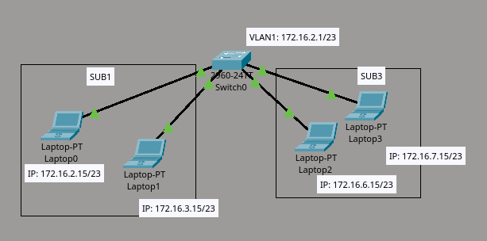
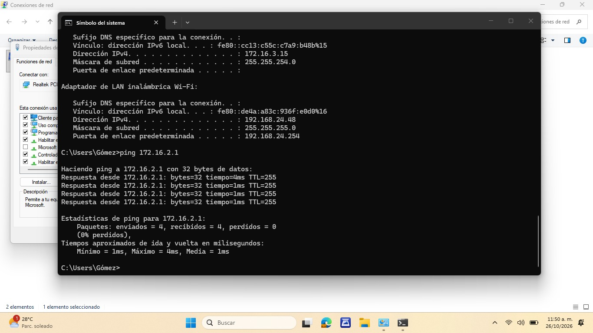
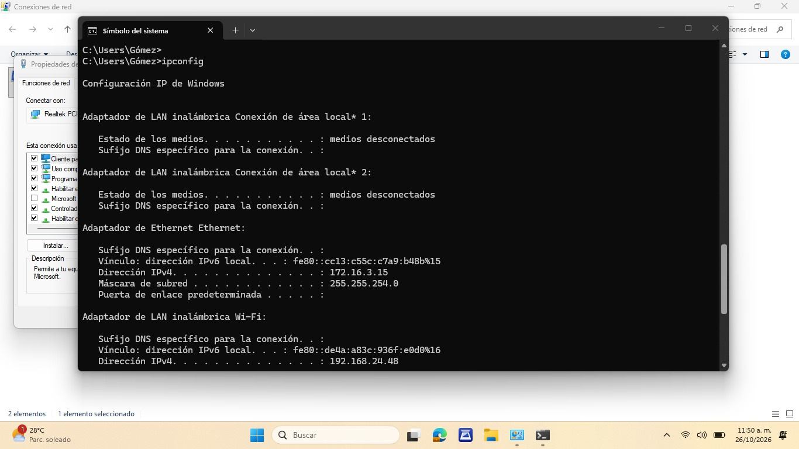
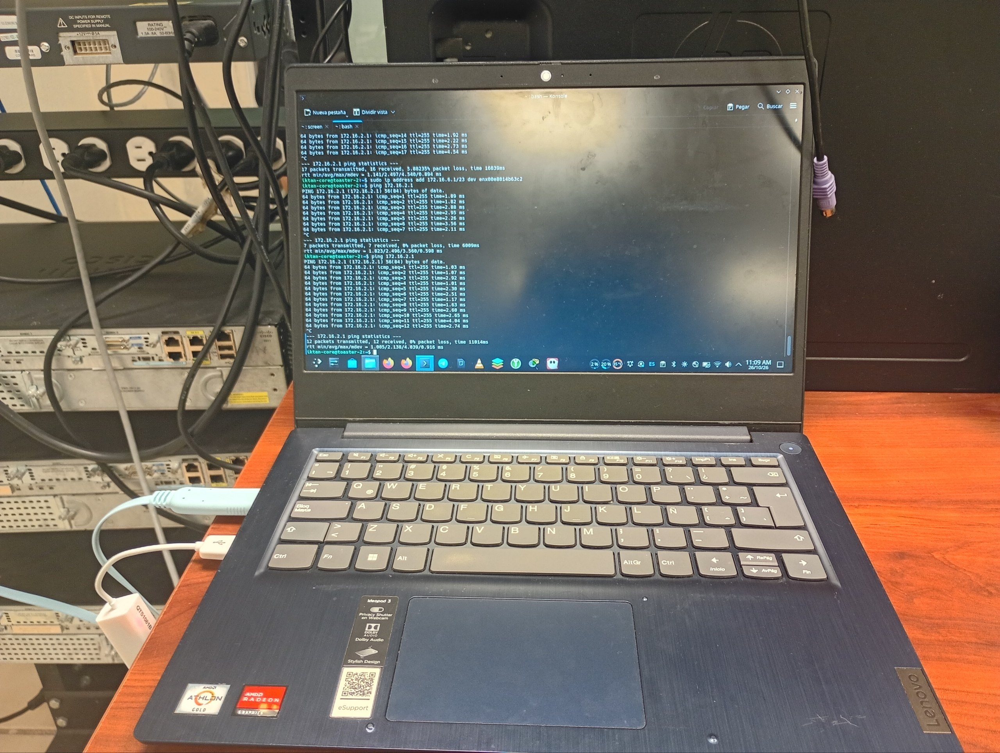

# INFORME DE PRÁCTICA DE LABORATORIO: SUBNETEO Y DIRECCIONAMIENTO EN REDES IPV4 CLASE B

## INTRODUCCIÓN

El presente informe documenta el desarrollo de la práctica de laboratorio enfocada en el subneteo y la configuración de equipos bajo un esquema de direccionamiento IPv4 Clase B. Esta actividad complementa y eleva la complejidad de los ejercicios previos, permitiendo aplicar los conocimientos de segmentación en un espacio de direcciones de mayor escala. 
A lo largo del documento, se describen de manera general las etapas del desarrollo: desde el diseño lógico de las subredes Y la asignación de rangos de direcciones IP, hasta la configuración de los equipos y la validación de la conectividad. Finalmente, se exponen los desafíos técnicos encontrados durante la implementación y las estrategias de solución aplicadas, consolidando así la experiencia práctica en el área de infraestructura de redes.

---

## OBJETIVOS

### Objetivo General
Implementar el subneteo de una red IPv4 Clase B mediante la configuración de switches y la asignación de direcciones IP a equipos en subredes distintas, para validar el aislamiento lógico del tráfico mediante pruebas de conectividad fallidas (ping) entre segmentos de red.

### Objetivos Específicos

1.  **Calcular** el esquema de subneteo de una red Clase B, determinando la máscara de subred, el rango de direcciones utilizables y las direcciones de red y broadcast para cada segmento.

2.  **Configurar** los switches y asignar direcciones IP a las laptops correspondientes a cada subred, estableciendo correctamente los parámetros de red (IP, máscara de subred y gateway).

3. **Validar** el correcto funcionamiento del subneteo mediante pruebas de conectividad (`ping`), comprobando la comunicación exitosa dentro de la misma subred y el aislamiento del tráfico entre subredes distintas.

---

## SUSTENTO TEÓRICO

### 1. Dirección IPv4 y su Clasificación

El protocolo IPv4 (Internet Protocol version 4) constituye el estándar fundamental de comunicación en redes de datos, utilizando direcciones de 32 bits que permiten identificar de manera única a los dispositivos en una red. Estas direcciones se representan en notación decimal punteada, divididas en cuatro octetos (por ejemplo, 172.16.0.1).

Las direcciones IPv4 se clasifican en cinco categorías principales (A, B, C, D y E), cada una diseñada para satisfacer diferentes necesidades de escalabilidad y propósito en la arquitectura de redes:

- **Clase A:** Destinada a redes de gran envergadura, con un rango de 0.0.0.0 a 127.255.255.255, utilizando 8 bits para red y 24 bits para hosts.
- **Clase B:** Diseñada para redes de tamaño mediano a grande, abarcando el rango de 128.0.0.0 a 191.255.255.255, con una distribución equilibrada de 16 bits para red y 16 bits para hosts.
- **Clase C:** Empleada en redes de área local (LAN) pequeñas, con un rango de 192.0.0.0 a 223.255.255.255, utilizando 24 bits para red y 8 bits para hosts.
- **Clase D:** Reservada para direcciones de multicast (224.0.0.0 a 239.255.255.255).
- **Clase E:** Destinada a fines experimentales y de investigación (240.0.0.0 a 255.255.255.255).

### 2. Redes IPv4 Clase B: Características Técnicas

Las redes Clase B representan un punto intermedio en la jerarquía de direccionamiento IPv4, siendo particularmente relevantes para organizaciones de tamaño medio que requieren un equilibrio entre el número de redes disponibles y la cantidad de hosts por red. Sus características fundamentales incluyen:

- **Rango de direcciones:** 128.0.0.0 a 191.255.255.255
- **Máscara de subred por defecto:** 255.255.0.0 (/16 en notación CIDR)
- **Bits de red:** 16 bits (dos primeros octetos)
- **Bits de host:** 16 bits (dos últimos octetos)
- **Capacidad de hosts por red:** 65,534 direcciones utilizables ($$2^{16} - 2$$, excluyendo la dirección de red y broadcast)
- **Identificación binaria:** Los dos primeros bits del primer octeto son siempre "10"

Esta clase de direccionamiento es ampliamente utilizada en entornos corporativos, instituciones educativas y organizaciones que requieren segmentar su infraestructura de red en múltiples subredes lógicas.

### 3. Subneteo: Fundamentos y Aplicación Práctica

El subneteo (subnetting) es una técnica esencial en el diseño de redes que permite dividir un espacio de direcciones de red grande en segmentos más pequeños y manejables, denominados subredes. Este proceso se fundamenta en el préstamo de bits de la porción de host para crear una subcapa de red adicional, logrando así:

- **Optimización del espacio de direcciones:** Evita el desperdicio de direcciones IP al asignar únicamente las necesarias para cada segmento de red.
- **Reducción de la congestión de tráfico:** Al segmentar la red, se limita el dominio de broadcast, mejorando el rendimiento general de la infraestructura.
- **Mejora en la seguridad y administración:** Permite aislar lógicamente diferentes departamentos o grupos de trabajo, facilitando la implementación de políticas de seguridad y la gestión administrativa.
- **Escalabilidad:** Facilita el crecimiento ordenado de la red sin comprometer su desempeño.

### 4. Máscara de Subred y Cálculo de Subredes

La máscara de subred es un parámetro crítico que define los límites entre la porción de red y la porción de host de una dirección IP. En el contexto de redes Clase B, la máscara por defecto 255.255.0.0 puede ser modificada mediante el préstamo de bits adicionales para crear subredes personalizadas según los requisitos específicos de la organización.

El proceso de subneteo implica:
1. Determinar el número de subredes requeridas.
2. Calcular los bits necesarios a prestar de la porción de host.
3. Derivar la nueva máscara de subred.
4. Identificar el rango de direcciones, la dirección de red y la dirección de broadcast para cada subred.
5. Establecer el rango de direcciones utilizables para hosts.

### 5. Justificación de la Práctica

El dominio del subneteo en redes Clase B es fundamental para la formación de técnicos superiores en infraestructura de redes digitales, ya que representa un escenario común en el ámbito profesional donde se requiere balancear la capacidad de hosts con la necesidad de segmentación lógica. Esta práctica permite validar experimentalmente los conceptos teóricos de direccionamiento IP, configuración de dispositivos de red y verificación de conectividad, consolidando las competencias necesarias para el diseño e implementación de redes empresariales eficientes y escalables.

---


## DESARROLLO TÉCNICO

### 1. Configuración del Switch

A continuación se detalla la configuración base del switch Cisco 2960-24TT utilizado en la práctica:

```cisco
! Configuración inicial del switch
Switch> enable
Switch# configure terminal

! Configuración de hostname
Switch(config)# hostname SW-SUB1A

! Configuración de contraseñas
SW-SUB1A(config)# enable secret class
SW-SUB1A(config)# line console 0
SW-SUB1A(config-line)# password cisco
SW-SUB1A(config-line)# login
SW-SUB1A(config-line)# exit

! Configuración de banner MOTD
SW-SUB1A(config)# banner motd "la cebolla"

! Configuración de la interfaz VLAN 1
SW-SUB1A(config)# interface vlan 1
SW-SUB1A(config-if)# ip address 172.16.2.1 255.255.254.0
SW-SUB1A(config-if)# no shutdown
SW-SUB1A(config-if)# exit

! Guardar configuración
SW-SUB1A# copy running-config startup-config
```

**Nota:** Antes de iniciar la configuración, se ejecutó el comando `erase startup-config` para limpiar cualquier configuración previa y garantizar un entorno limpio.

---

### 2. Asignación de Direcciones IP a las Laptops




De acuerdo al diagrama lógico de la red, se configuraron las siguientes direcciones IP en los equipos finales:

| Equipo | Dirección IP | Máscara de Subred | Subred Asignada |
|--------|--------------|-------------------|-----------------|
| Laptop0 | 172.16.2.15 | 255.255.254.0 (/23) | SUB1 |
| Laptop1 | 172.16.3.15 | 255.255.254.0 (/23) | SUB1 |
| Laptop2 | 172.16.6.15 | 255.255.254.0 (/23) | SUB3 |
| Laptop3 | 172.16.7.15 | 255.255.254.0 (/23) | SUB3 |

**Gateway por defecto:** 172.16.255.254

---

### 3. Resultados Esperados

El objetivo principal de la práctica era validar el aislamiento lógico entre subredes mediante pruebas de conectividad:

✅ **Ping exitoso** entre equipos de la **misma subred** (ej: Laptop0 ↔ Laptop1)  
❌ **Ping fallido** entre equipos de **diferentes subredes** (ej: Laptop0 ↔ Laptop2)

Este comportamiento confirma que el subneteo fue implementado correctamente y que el tráfico está siendo segmentado según el diseño de red.

---

### 4. Problema Encontrado

Durante las pruebas de continuidad iniciales, se detectó un comportamiento anómalo: **las laptops pertenecientes a la misma subred no podían comunicarse entre sí**, lo cual contradecía el resultado esperado.

---

### 5. Diagnóstico

Se procedió a realizar un análisis sistemático para identificar la causa raíz del problema:

### Paso 1: Verificación de conectividad con el switch
```bash
# Desde Laptop0 hacia el switch
ping 172.16.2.1

# Desde el switch hacia Laptop0
ping 172.16.2.15
```
**Resultado:** Ping exitoso en ambos sentidos.  
**Conclusión:** Se descarta error de Capa 2 (enlace físico y configuración del switch).

### Paso 2: Prueba cruzada entre sistemas operativos
Se realizó una prueba de conectividad entre una laptop con **Windows** y otra con **Debian GNU/Linux**:

```bash
# Desde Windows hacia Debian
ping 172.16.2.15  # ✅ Exitoso

# Desde Debian hacia Windows
ping 172.16.3.15  # ❌ Fallido
```

**Observación crítica:** El primer ping fue exitoso, pero el segundo falló. Este comportamiento asimétrico indicó que el problema no era de configuración de red, sino de **políticas de seguridad en el sistema operativo**.

---

### 6. Causa Raíz Identificada

El problema fue causado por el **Firewall de Windows configurado en modo "Red Pública"**.

**Sustento técnico:**  
El Firewall de Windows, cuando está configurado en perfil "Público", está diseñado para ocultar el dispositivo y prevenir que sea mapeado por otros equipos en la red. En este modo, Windows **rechaza automáticamente tráfico ICMPv4** (ping), ya que lo considera una posible amenaza de reconocimiento de red.

---

### 7. Solución y Recomendaciones

Para verificar y modificar la configuración del Firewall de Windows en prácticas posteriores, se recomienda utilizar los siguientes comandos en PowerShell (con privilegios de administrador):

```powershell
# Ver el perfil de red actual
Get-NetConnectionProfile

# Cambiar el perfil de red a "Privado" (permite ICMP)
Set-NetConnectionProfile -InterfaceIndex <número> -NetworkCategory Private

# Habilitar reglas de ICMPv4 entrantes
Enable-NetFirewallRule -DisplayGroup "File and Printer Sharing"

# Verificar reglas de firewall activas
Get-NetFirewallRule | Where-Object {$_.DisplayGroup -like "*ICMP*"} | Format-Table Name, Enabled, Profile

# Deshabilitar temporalmente el firewall (solo para pruebas en laboratorio)
Set-NetFirewallProfile -Profile Public -Enabled False
```

**Nota importante:** En entornos de producción, nunca se debe deshabilitar el firewall completamente. La práctica correcta es crear reglas específicas que permitan el tráfico necesario manteniendo la seguridad.

---

### 8. Conclusiones del Desarrollo

La práctica permitió validar exitosamente el concepto de subneteo en redes Clase B. El problema encontrado con el Firewall de Windows representó una oportunidad de aprendizaje adicional sobre cómo las políticas de seguridad del sistema operativo pueden interferir con las pruebas de conectividad de red, un escenario común en entornos reales de TI.

---

> **📝 Nota del editor:**  
> *Para quienes nos leen: no cometan el error de asumir complejidad donde no la hay. Un miembro del equipo, aferrado a la idea de que el error estaba en el switch, se puso a configurar otro equipo a pesar de las pruebas anteriores (que por cierto hice yo y fui ignorado). Esto nos hizo perder mucho tiempo valioso cuando la respuesta estaba simplemente en el firewall de Windows. Irónicamente, lo más simple suele ser la respuesta. La próxima vez, revisen lo obvio primero y, sobre todo, escuchen al compañero que tiene la razón.* 😅

---

## INTERPRETACIÓN DE RESULTADOS

De acuerdo con los objetivos planteados al inicio de la práctica, se presentan los resultados obtenidos:

### 1. Implementación del Subneteo de Red IPv4 Clase B

Se logró implementar correctamente el esquema de subneteo de una red Clase B utilizando una máscara `/23` (255.255.254.0), lo que permitió dividir el espacio de direcciones en subredes lógicas independientes. Como resultado, se validó el aislamiento del tráfico entre segmentos de red distintos, cumpliendo con el objetivo principal de la práctica.

### 2. Cálculo del Esquema de Subneteo

Se determinaron correctamente los rangos de direcciones IP, las direcciones de red, las direcciones de broadcast y las direcciones utilizables para cada subred. El uso de la máscara `/23` permitió un balance adecuado entre el número de hosts por subred y la cantidad de segmentos disponibles, optimizando el uso del espacio de direccionamiento.

### 3. Configuración de Switches y Asignación de IPs

Se configuró exitosamente el switch Cisco 2960-24TT con su respectiva interfaz VLAN 1, hostname, contraseñas y banner MOTD. Asimismo, se asignaron las direcciones IP correspondientes a cada laptop según el diagrama lógico de la red, verificando que cada equipo perteneciera correctamente a su subred asignada.

### 4. Validación mediante Pruebas de Conectividad

Las pruebas de ping arrojaron los siguientes resultados:

- ✅ **Comunicación intra-subred:** Las laptops dentro de la misma subred (ej. Laptop0 y Laptop1) se comunicaron exitosamente, confirmando la correcta configuración de la máscara de subred y el segmento de red.
- ❌ **Aislamiento inter-subred:** Las laptops de diferentes subredes (ej. Laptop0 y Laptop2) no pudieron comunicarse entre sí, lo cual **valida el correcto funcionamiento del subneteo**, ya que sin un dispositivo de Capa 3 (router) que interconecte las subredes, el tráfico no puede cruzar los límites de broadcast.

### 5. Hallazgo Adicional: Interferencia del Firewall de Windows

Durante las pruebas de conectividad, se identificó que el Firewall de Windows en modo "Red Pública" bloqueaba las solicitudes ICMPv4 entrantes, generando falsos negativos en las pruebas de ping. Tras diagnosticar y corregir este comportamiento, se confirmó que las políticas de seguridad del sistema operativo pueden interferir significativamente con las pruebas de conectividad, un aspecto crítico a considerar en entornos reales de TI.

---

## CONCLUSIONES

Con base en los resultados obtenidos durante el desarrollo de la práctica, se presentan las siguientes conclusiones:

### 1. Validación del Subneteo en Redes Clase B

Se comprobó experimentalmente que el subneteo de una red IPv4 Clase B con máscara `/23` permite segmentar correctamente el espacio de direcciones en subredes lógicas independientes. El aislamiento del tráfico entre subredes distintas se validó mediante las pruebas de ping, confirmando que sin un dispositivo de Capa 3 (router) que interconecte los segmentos, la comunicación entre ellos es imposible, tal como lo establece el modelo OSI.

### 2. Eficiencia en el Cálculo de Subredes

El proceso de cálculo del esquema de subneteo demostró ser una habilidad fundamental para el diseño de redes. La máscara `/23` permitió un balance óptimo entre el número de hosts disponibles por subred (510 direcciones utilizables) y la cantidad de segmentos creados, evitando el desperdicio de direcciones IP y optimizando el uso del espacio de direccionamiento.

### 3. Importancia de la Configuración Correcta de Dispositivos

La configuración adecuada del switch (hostname, contraseñas, banner MOTD e interfaz VLAN) y la asignación precisa de direcciones IP a los equipos finales son pasos críticos que determinan el funcionamiento correcto de la red. Un error en cualquiera de estos parámetros puede comprometer la conectividad y la seguridad de la infraestructura.

### 4. Impacto de las Políticas de Seguridad en las Pruebas de Conectividad

El hallazgo del Firewall de Windows en modo "Red Pública" bloqueando el tráfico ICMPv4 reveló un aspecto práctico crucial: las políticas de seguridad del sistema operativo pueden interferir significativamente con las pruebas de conectividad de red. Este escenario, común en entornos reales de TI, subraya la importancia de considerar no solo la configuración de red, sino también los factores del sistema operativo al diagnosticar problemas de conectividad.

### 5. Metodología de Troubleshooting

La práctica reforzó la importancia de aplicar una metodología sistemática de diagnóstico: partir de lo simple (verificación de conectividad básica) hacia lo complejo (análisis de políticas de seguridad), evitando asumir complejidad innecesaria. El tiempo perdido al ignorar las pruebas iniciales y enfocarse en reconfigurar el switch demostró que el troubleshooting efectivo requiere disciplina y seguimiento de evidencias, no suposiciones.

### Conclusión General

La práctica de laboratorio cumplió satisfactoriamente con los objetivos planteados, permitiendo consolidar los conocimientos teóricos sobre subneteo de redes Clase B mediante la implementación práctica. Además, el desafío encontrado con el Firewall de Windows proporcionó un aprendizaje adicional invaluable sobre la interacción entre la configuración de red y las políticas de seguridad del sistema operativo, preparando al estudiante para enfrentar escenarios reales en el ámbito profesional de la infraestructura de redes digitales.
s
---

## BIBLIOGRAFÍA

CloudNS. (s.f.). *What is IPv4? Everything you need to know*. Recuperado el 27 de octubre de 2026, de https://www.cloudns.net/blog/what-is-ipv4-everything-you-need-to-know/

---

## ANEXOS

Evidencias fotograficas reales 







